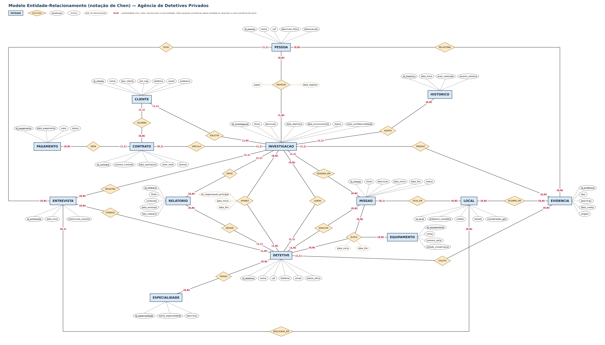

# 02. Modelo Conceitual (MER / DER)

## 1. Descrição do Modelo
O Modelo Entidade-Relacionamento (MER) abaixo representa a estrutura abstrata do domínio da Agência de Detetives Privados, identificando as entidades, seus atributos principais, identificadores e as cardinalidades mínimas e máximas de cada relacionamento.

## 2. Entidades, Atributos e Identificadores (Identificadores Conceituais)

* **`CLIENTE`**
  * **Identificador:** `id_cliente`
  * **Atributos:** `nome`, `tipo_cliente` (`PF`/`PJ`), `cpf_cnpj`, `telefone`, `email`, `endereco`
* **`DETETIVE`**
  * **Identificador:** `id_detetive`
  * **Atributos:** `nome`, `cpf`, `telefone`, `email`, `status_ativo`
* **`ESPECIALIDADE`**
  * **Identificador:** `id_especialidade`
  * **Atributos:** `nome_especialidade`, `descricao`
* **`INVESTIGACAO`**
  * **Identificador:** `id_investigacao`
  * **Atributos:** `titulo`, `descricao`, `data_abertura`, `data_encerramento`, `status`, `nivel_confidencialidade`
* **`MISSAO`**
  * **Identificador:** `id_missao`
  * **Atributos:** `titulo`, `descricao`, `data_inicio`, `data_fim`, `status`
* **`PESSOA`**
  * **Identificador:** `id_pessoa`
  * **Atributos:** `nome`, `cpf`, `descricao_fisica`, `observacoes`
* **`ENTREVISTA`**
  * **Identificador:** `id_entrevista`
  * **Atributos:** `data_hora`, `transcricao_resumo`
* **`EVIDENCIA`**
  * **Identificador:** `id_evidencia`
  * **Atributos:** `tipo`, `descricao`, `data_coleta`, `origem`
* **`LOCAL`**
  * **Identificador:** `id_local`
  * **Atributos:** `endereco_completo`, `cidade`, `estado`, `coordenadas_gps`
* **`RELATORIO`**
  * **Identificador:** `id_relatorio`
  * **Atributos:** `titulo`, `conteudo`, `data_emissao`, `tipo_relatorio`
* **`CONTRATO`**
  * **Identificador:** `id_contrato`
  * **Atributos:** `numero_contrato`, `data_assinatura`, `valor_total`, `termos`
* **`PAGAMENTO`**
  * **Identificador:** `id_pagamento`
  * **Atributos:** `data_pagamento`, `valor`, `status`
* **`EQUIPAMENTO`**
  * **Identificador:** `id_equipamento`
  * **Atributos:** `nome`, `numero_serie`, `estado_conservacao`
* **`HISTORICO`**
  * **Identificador:** `id_historico`
  * **Atributos:** `data_hora`, `acao_realizada`, `usuario_sistema`

---

## 3. Relacionamentos e Cardinalidades (Mín, Máx)

**Convenção de leitura (única para todo o modelo):** a cardinalidade escrita junto a uma entidade indica quantas ocorrências **dessa** entidade podem estar associadas a **uma** ocorrência da outra entidade do relacionamento. Exemplo: em `CLIENTE (1,1) — SOLICITA — (1,N) INVESTIGACAO`, cada investigação pertence a exatamente um cliente e cada cliente solicita uma ou várias investigações.

| Relacionamento | Entidade A | Entidade B | Atributos do relacionamento | Leitura |
| :--- | :--- | :--- | :--- | :--- |
| **SOLICITA** | CLIENTE (1,1) | (1,N) INVESTIGACAO | — | Cada CLIENTE relaciona-se com (1,N) INVESTIGACAO; cada INVESTIGACAO relaciona-se com (1,1) CLIENTE. |
| **CELEBRA** | CLIENTE (1,1) | (0,N) CONTRATO | — | Cada CLIENTE relaciona-se com (0,N) CONTRATO; cada CONTRATO relaciona-se com (1,1) CLIENTE. |
| **VINCULA** | CONTRATO (0,1) | (1,1) INVESTIGACAO | — | Cada CONTRATO relaciona-se com (1,1) INVESTIGACAO; cada INVESTIGACAO relaciona-se com (0,1) CONTRATO. |
| **GERA** | CONTRATO (1,1) | (0,N) PAGAMENTO | — | Cada CONTRATO relaciona-se com (0,N) PAGAMENTO; cada PAGAMENTO relaciona-se com (1,1) CONTRATO. |
| **LIDERA** | DETETIVE (1,1) | (0,N) INVESTIGACAO | — | Cada DETETIVE relaciona-se com (0,N) INVESTIGACAO; cada INVESTIGACAO relaciona-se com (1,1) DETETIVE. |
| **ATRIBUI** | INVESTIGACAO (0,N) | (1,N) DETETIVE | `eh_responsavel_principal`, `data_inicio`, `data_fim` | Cada INVESTIGACAO relaciona-se com (1,N) DETETIVE; cada DETETIVE relaciona-se com (0,N) INVESTIGACAO. |
| **POSSUI** | DETETIVE (0,N) | (0,N) ESPECIALIDADE | — | Cada DETETIVE relaciona-se com (0,N) ESPECIALIDADE; cada ESPECIALIDADE relaciona-se com (0,N) DETETIVE. |
| **DIVIDIDA_EM** | INVESTIGACAO (1,1) | (0,N) MISSAO | — | Cada INVESTIGACAO relaciona-se com (0,N) MISSAO; cada MISSAO relaciona-se com (1,1) INVESTIGACAO. |
| **EXECUTA** | MISSAO (0,N) | (1,N) DETETIVE | — | Cada MISSAO relaciona-se com (1,N) DETETIVE; cada DETETIVE relaciona-se com (0,N) MISSAO. |
| **ALOCA** (ternário) | MISSAO (0,N) / EQUIPAMENTO (0,N) / DETETIVE (0,N) | | `data_inicio`, `data_fim` | Um DETETIVE utiliza um EQUIPAMENTO em uma MISSAO durante um período; cada entidade pode participar de (0,N) alocações. |
| **ENVOLVE** | INVESTIGACAO (1,N) | (0,N) PESSOA | `papel`, `data_registro` | Cada INVESTIGACAO relaciona-se com (0,N) PESSOA; cada PESSOA relaciona-se com (1,N) INVESTIGACAO. |
| **REGISTRA** | INVESTIGACAO (1,1) | (0,N) ENTREVISTA | — | Cada INVESTIGACAO relaciona-se com (0,N) ENTREVISTA; cada ENTREVISTA relaciona-se com (1,1) INVESTIGACAO. |
| **CONDUZ** | ENTREVISTA (0,N) | (1,N) DETETIVE | — | Cada ENTREVISTA relaciona-se com (1,N) DETETIVE; cada DETETIVE relaciona-se com (0,N) ENTREVISTA. |
| **OUVE** | ENTREVISTA (0,N) | (1,1) PESSOA | — | Cada ENTREVISTA relaciona-se com (1,1) PESSOA; cada PESSOA relaciona-se com (0,N) ENTREVISTA. |
| **PRODUZ** | INVESTIGACAO (1,1) | (0,N) EVIDENCIA | — | Cada INVESTIGACAO relaciona-se com (0,N) EVIDENCIA; cada EVIDENCIA relaciona-se com (1,1) INVESTIGACAO. |
| **COLETA** | DETETIVE (1,1) | (0,N) EVIDENCIA | — | Cada DETETIVE relaciona-se com (0,N) EVIDENCIA; cada EVIDENCIA relaciona-se com (1,1) DETETIVE. |
| **RELACIONA** | EVIDENCIA (0,N) | (0,N) PESSOA | — | Cada EVIDENCIA relaciona-se com (0,N) PESSOA; cada PESSOA relaciona-se com (0,N) EVIDENCIA. |
| **OCORRE_EM** | EVIDENCIA (0,N) | (0,N) LOCAL | — | Cada EVIDENCIA relaciona-se com (0,N) LOCAL; cada LOCAL relaciona-se com (0,N) EVIDENCIA. |
| **ATUA_EM** | MISSAO (0,1) | (0,N) LOCAL | — | Cada MISSAO relaciona-se com (0,N) LOCAL; cada LOCAL relaciona-se com (0,1) MISSAO. |
| **REALIZADA_EM** | ENTREVISTA (0,1) | (0,N) LOCAL | — | Cada ENTREVISTA relaciona-se com (0,N) LOCAL; cada LOCAL relaciona-se com (0,1) ENTREVISTA. |
| **EMITE** | INVESTIGACAO (1,1) | (0,N) RELATORIO | — | Cada INVESTIGACAO relaciona-se com (0,N) RELATORIO; cada RELATORIO relaciona-se com (1,1) INVESTIGACAO. |
| **REDIGE** | DETETIVE (1,1) | (0,N) RELATORIO | — | Cada DETETIVE relaciona-se com (0,N) RELATORIO; cada RELATORIO relaciona-se com (1,1) DETETIVE. |
| **AUDITA** | INVESTIGACAO (1,1) | (0,N) HISTORICO | — | Cada INVESTIGACAO relaciona-se com (0,N) HISTORICO; cada HISTORICO relaciona-se com (1,1) INVESTIGACAO. |

### Observações sobre o modelo
* **LIDERA e ATRIBUI** são relacionamentos distintos entre DETETIVE e INVESTIGACAO: LIDERA indica o detetive responsável atual (RB06); ATRIBUI registra toda a equipe e o histórico de participação (RB05, RB07).
* **ALOCA** é ternário porque a regra RB28 trata do uso de um equipamento *por um detetive* em um período, dentro de uma missão.
* **LOCAL** representa um ponto de atuação registrado para uma missão (ATUA_EM) ou para uma entrevista (REALIZADA_EM); as evidências podem ser associadas a esses locais (OCORRE_EM).
* As cardinalidades mínimas iguais a 1 do lado "N" (por exemplo, cada investigação com ao menos um detetive atribuído) são regras do domínio verificadas pela aplicação, pois não podem ser impostas por uma chave estrangeira.

---

## 4. Diagrama MER (notação de Chen)

Retângulos representam entidades, losangos representam relacionamentos, elipses representam atributos (identificadores sublinhados; atributos de relacionamento em linha tracejada). As cardinalidades seguem a convenção da seção 3. Cada cardinalidade está posicionada sobre a linha, junto à entidade a que se refere.

Versão vetorial (permite ampliar sem perda de qualidade): [mer_chen.svg](mer_chen.svg)
