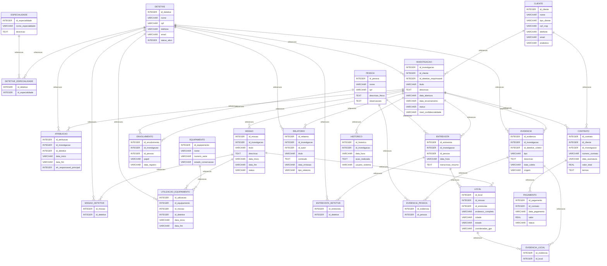

# 03. Esquema Relacional Lógico e Normalização
## Summary

- [Introduction](#introduction)
- [Database Type](#database-type)
- [Table Structure](#table-structure)
	- [HISTORICO](#historico)
	- [PAGAMENTO](#pagamento)
	- [CONTRATO](#contrato)
	- [RELATORIO](#relatorio)
	- [EVIDENCIA_LOCAL](#evidencia_local)
	- [LOCAL](#local)
	- [EVIDENCIA_PESSOA](#evidencia_pessoa)
	- [EVIDENCIA](#evidencia)
	- [ENTREVISTA_DETETIVE](#entrevista_detetive)
	- [ENTREVISTA](#entrevista)
	- [ENVOLVIMENTO](#envolvimento)
	- [PESSOA](#pessoa)
	- [UTILIZACAO_EQUIPAMENTO](#utilizacao_equipamento)
	- [EQUIPAMENTO](#equipamento)
	- [MISSAO_DETETIVE](#missao_detetive)
	- [MISSAO](#missao)
	- [ATRIBUICAO](#atribuicao)
	- [INVESTIGACAO](#investigacao)
	- [DETETIVE_ESPECIALIDADE](#detetive_especialidade)
	- [ESPECIALIDADE](#especialidade)
	- [DETETIVE](#detetive)
	- [CLIENTE](#cliente)
- [Relationships](#relationships)
- [Database Diagram](#database-diagram)

## Introduction

## Database type

- **Database system:** SQLite (v3)
## Table structure

### HISTORICO

| Name                | Type    | Settings                   | References | Note |
| ------------------- | ------- | -------------------------- | ---------- | ---- |
| **id_historico**    | INTEGER | 🔑 PK, null, autoincrement |            |      |
| **id_investigacao** | INTEGER | not null                   |            |      |
| **data_hora**       | VARCHAR | not null                   |            |      |
| **acao_realizada**  | TEXT    | not null                   |            |      |
| **usuario_sistema** | VARCHAR | not null                   |            |      | 

### PAGAMENTO

| Name               | Type    | Settings                    | References | Note |
| ------------------ | ------- | --------------------------- | ---------- | ---- |
| **id_pagamento**   | INTEGER | 🔑 PK, null, autoincrement  |            |      |
| **id_contrato**    | INTEGER | not null                    |            |      |
| **data_pagamento** | VARCHAR | not null                    |            |      |
| **valor**          | REAL    | not null                    |            |      |
| **status**         | VARCHAR | not null, default: PENDENTE |            |      | 

### CONTRATO

| Name                | Type    | Settings                   | References                        | Note |
| ------------------- | ------- | -------------------------- | --------------------------------- | ---- |
| **id_contrato**     | INTEGER | 🔑 PK, null, autoincrement | fk_CONTRATO_id_contrato_PAGAMENTO |      |
| **id_cliente**      | INTEGER | not null                   |                                   |      |
| **id_investigacao** | INTEGER | not null, unique           |                                   |      |
| **numero_contrato** | VARCHAR | not null, unique           |                                   |      |
| **data_assinatura** | VARCHAR | not null                   |                                   |      |
| **valor_total**     | REAL    | not null                   |                                   |      |
| **termos**          | TEXT    | not null                   |                                   |      | 

### RELATORIO

| Name                | Type    | Settings                   | References | Note |
| ------------------- | ------- | -------------------------- | ---------- | ---- |
| **id_relatorio**    | INTEGER | 🔑 PK, null, autoincrement |            |      |
| **id_investigacao** | INTEGER | not null                   |            |      |
| **id_autor**        | INTEGER | not null                   |            |      |
| **titulo**          | VARCHAR | not null                   |            |      |
| **conteudo**        | TEXT    | not null                   |            |      |
| **data_emissao**    | VARCHAR | not null                   |            |      |
| **tipo_relatorio**  | VARCHAR | not null                   |            |      | 

### EVIDENCIA_LOCAL

| Name             | Type    | Settings    | References | Note |
| ---------------- | ------- | ----------- | ---------- | ---- |
| **id_evidencia** | INTEGER | 🔑 PK, null |            |      |
| **id_local**     | INTEGER | 🔑 PK, null |            |      | 

### LOCAL

| Name                  | Type    | Settings                   | References                        | Note |
| --------------------- | ------- | -------------------------- | --------------------------------- | ---- |
| **id_local**          | INTEGER | 🔑 PK, null, autoincrement | fk_LOCAL_id_local_EVIDENCIA_LOCAL |      |
| **id_missao**         | INTEGER | null                       |                                   |      |
| **id_entrevista**     | INTEGER | null                       |                                   |      |
| **endereco_completo** | VARCHAR | not null                   |                                   |      |
| **cidade**            | VARCHAR | not null                   |                                   |      |
| **estado**            | VARCHAR | not null                   |                                   |      |
| **coordenadas_gps**   | VARCHAR | null                       |                                   |      | 

### EVIDENCIA_PESSOA

| Name             | Type    | Settings    | References | Note |
| ---------------- | ------- | ----------- | ---------- | ---- |
| **id_evidencia** | INTEGER | 🔑 PK, null |            |      |
| **id_pessoa**    | INTEGER | 🔑 PK, null |            |      | 

### EVIDENCIA

| Name                    | Type    | Settings                   | References                                                                            | Note |
| ----------------------- | ------- | -------------------------- | ------------------------------------------------------------------------------------- | ---- |
| **id_evidencia**        | INTEGER | 🔑 PK, null, autoincrement | fk_EVIDENCIA_id_evidencia_EVIDENCIA_PESSOA, fk_EVIDENCIA_id_evidencia_EVIDENCIA_LOCAL |      |
| **id_investigacao**     | INTEGER | not null                   |                                                                                       |      |
| **id_detetive_coletor** | INTEGER | not null                   |                                                                                       |      |
| **tipo**                | VARCHAR | not null                   |                                                                                       |      |
| **descricao**           | TEXT    | not null                   |                                                                                       |      |
| **data_coleta**         | VARCHAR | not null                   |                                                                                       |      |
| **origem**              | VARCHAR | not null                   |                                                                                       |      | 

### ENTREVISTA_DETETIVE

| Name              | Type    | Settings    | References | Note |
| ----------------- | ------- | ----------- | ---------- | ---- |
| **id_entrevista** | INTEGER | 🔑 PK, null |            |      |
| **id_detetive**   | INTEGER | 🔑 PK, null |            |      | 

### ENTREVISTA

| Name                   | Type    | Settings                   | References                                                                         | Note |
| ---------------------- | ------- | -------------------------- | ---------------------------------------------------------------------------------- | ---- |
| **id_entrevista**      | INTEGER | 🔑 PK, null, autoincrement | fk_ENTREVISTA_id_entrevista_ENTREVISTA_DETETIVE, fk_ENTREVISTA_id_entrevista_LOCAL |      |
| **id_investigacao**    | INTEGER | not null                   |                                                                                    |      |
| **id_pessoa**          | INTEGER | not null                   |                                                                                    |      |
| **data_hora**          | VARCHAR | not null                   |                                                                                    |      |
| **transcricao_resumo** | TEXT    | not null                   |                                                                                    |      | 

### ENVOLVIMENTO

| Name                | Type    | Settings                   | References | Note |
| ------------------- | ------- | -------------------------- | ---------- | ---- |
| **id_envolvimento** | INTEGER | 🔑 PK, null, autoincrement |            |      |
| **id_investigacao** | INTEGER | not null                   |            |      |
| **id_pessoa**       | INTEGER | not null                   |            |      |
| **papel**           | VARCHAR | not null                   |            |      |
| **data_registro**   | VARCHAR | not null                   |            |      | 

### PESSOA

| Name                 | Type    | Settings                   | References                                                                                             | Note |
| -------------------- | ------- | -------------------------- | ------------------------------------------------------------------------------------------------------ | ---- |
| **id_pessoa**        | INTEGER | 🔑 PK, null, autoincrement | fk_PESSOA_id_pessoa_ENVOLVIMENTO, fk_PESSOA_id_pessoa_ENTREVISTA, fk_PESSOA_id_pessoa_EVIDENCIA_PESSOA |      |
| **nome**             | VARCHAR | not null                   |                                                                                                        |      |
| **cpf**              | VARCHAR | null, unique               |                                                                                                        |      |
| **descricao_fisica** | TEXT    | null                       |                                                                                                        |      |
| **observacoes**      | TEXT    | null                       |                                                                                                        |      | 

### UTILIZACAO_EQUIPAMENTO

| Name               | Type    | Settings                   | References | Note |
| ------------------ | ------- | -------------------------- | ---------- | ---- |
| **id_utilizacao**  | INTEGER | 🔑 PK, null, autoincrement |            |      |
| **id_equipamento** | INTEGER | not null                   |            |      |
| **id_missao**      | INTEGER | not null                   |            |      |
| **id_detetive**    | INTEGER | not null                   |            |      |
| **data_inicio**    | VARCHAR | not null                   |            |      |
| **data_fim**       | VARCHAR | null                       |            |      | 

### EQUIPAMENTO

| Name                   | Type    | Settings                       | References                                           | Note |
| ---------------------- | ------- | ------------------------------ | ---------------------------------------------------- | ---- |
| **id_equipamento**     | INTEGER | 🔑 PK, null, autoincrement     | fk_EQUIPAMENTO_id_equipamento_UTILIZACAO_EQUIPAMENTO |      |
| **nome**               | VARCHAR | not null                       |                                                      |      |
| **numero_serie**       | VARCHAR | not null, unique               |                                                      |      |
| **estado_conservacao** | VARCHAR | not null, default: OPERACIONAL |                                                      |      | 

### MISSAO_DETETIVE

| Name            | Type    | Settings    | References | Note |
| --------------- | ------- | ----------- | ---------- | ---- |
| **id_missao**   | INTEGER | 🔑 PK, null |            |      |
| **id_detetive** | INTEGER | 🔑 PK, null |            |      | 

### MISSAO

| Name                | Type    | Settings                     | References                                                                                                 | Note |
| ------------------- | ------- | ---------------------------- | ---------------------------------------------------------------------------------------------------------- | ---- |
| **id_missao**       | INTEGER | 🔑 PK, null, autoincrement   | fk_MISSAO_id_missao_MISSAO_DETETIVE, fk_MISSAO_id_missao_UTILIZACAO_EQUIPAMENTO, fk_MISSAO_id_missao_LOCAL |      |
| **id_investigacao** | INTEGER | not null                     |                                                                                                            |      |
| **titulo**          | VARCHAR | not null                     |                                                                                                            |      |
| **descricao**       | TEXT    | not null                     |                                                                                                            |      |
| **data_inicio**     | VARCHAR | not null                     |                                                                                                            |      |
| **data_fim**        | VARCHAR | null                         |                                                                                                            |      |
| **status**          | VARCHAR | not null, default: PLANEJADA |                                                                                                            |      | 

### ATRIBUICAO

| Name                         | Type    | Settings                   | References | Note |
| ---------------------------- | ------- | -------------------------- | ---------- | ---- |
| **id_atribuicao**            | INTEGER | 🔑 PK, null, autoincrement |            |      |
| **id_investigacao**          | INTEGER | not null                   |            |      |
| **id_detetive**              | INTEGER | not null                   |            |      |
| **data_inicio**              | VARCHAR | not null                   |            |      |
| **data_fim**                 | VARCHAR | null                       |            |      |
| **eh_responsavel_principal** | INTEGER | not null, default: 0       |            |      | 

### INVESTIGACAO

| Name                        | Type    | Settings                    | References                                                                                                                                                                                                                                                                                                                                              | Note |
| --------------------------- | ------- | --------------------------- | ------------------------------------------------------------------------------------------------------------------------------------------------------------------------------------------------------------------------------------------------------------------------------------------------------------------------------------------------------- | ---- |
| **id_investigacao**         | INTEGER | 🔑 PK, null, autoincrement  | fk_INVESTIGACAO_id_investigacao_ATRIBUICAO, fk_INVESTIGACAO_id_investigacao_MISSAO, fk_INVESTIGACAO_id_investigacao_ENVOLVIMENTO, fk_INVESTIGACAO_id_investigacao_ENTREVISTA, fk_INVESTIGACAO_id_investigacao_EVIDENCIA, fk_INVESTIGACAO_id_investigacao_RELATORIO, fk_INVESTIGACAO_id_investigacao_CONTRATO, fk_INVESTIGACAO_id_investigacao_HISTORICO |      |
| **id_cliente**              | INTEGER | not null                    |                                                                                                                                                                                                                                                                                                                                                         |      |
| **id_detetive_responsavel** | INTEGER | not null                    |                                                                                                                                                                                                                                                                                                                                                         |      |
| **titulo**                  | VARCHAR | not null                    |                                                                                                                                                                                                                                                                                                                                                         |      |
| **descricao**               | TEXT    | not null                    |                                                                                                                                                                                                                                                                                                                                                         |      |
| **data_abertura**           | VARCHAR | not null                    |                                                                                                                                                                                                                                                                                                                                                         |      |
| **data_encerramento**       | VARCHAR | null                        |                                                                                                                                                                                                                                                                                                                                                         |      |
| **status**                  | VARCHAR | not null, default: ABERTA   |                                                                                                                                                                                                                                                                                                                                                         |      |
| **nivel_confidencialidade** | VARCHAR | not null, default: RESTRITO |                                                                                                                                                                                                                                                                                                                                                         |      | 

### DETETIVE_ESPECIALIDADE

| Name                 | Type    | Settings    | References | Note |
| -------------------- | ------- | ----------- | ---------- | ---- |
| **id_detetive**      | INTEGER | 🔑 PK, null |            |      |
| **id_especialidade** | INTEGER | 🔑 PK, null |            |      | 

### ESPECIALIDADE

| Name                   | Type    | Settings                   | References                                               | Note |
| ---------------------- | ------- | -------------------------- | -------------------------------------------------------- | ---- |
| **id_especialidade**   | INTEGER | 🔑 PK, null, autoincrement | fk_ESPECIALIDADE_id_especialidade_DETETIVE_ESPECIALIDADE |      |
| **nome_especialidade** | VARCHAR | not null, unique           |                                                          |      |
| **descricao**          | TEXT    | null                       |                                                          |      | 

### DETETIVE

| Name             | Type    | Settings                   | References                                                                                                                                                                                                                                                                                                                           | Note |
| ---------------- | ------- | -------------------------- | ------------------------------------------------------------------------------------------------------------------------------------------------------------------------------------------------------------------------------------------------------------------------------------------------------------------------------------ | ---- |
| **id_detetive**  | INTEGER | 🔑 PK, null, autoincrement | fk_DETETIVE_id_detetive_DETETIVE_ESPECIALIDADE, fk_DETETIVE_id_detetive_INVESTIGACAO, fk_DETETIVE_id_detetive_ATRIBUICAO, fk_DETETIVE_id_detetive_MISSAO_DETETIVE, fk_DETETIVE_id_detetive_UTILIZACAO_EQUIPAMENTO, fk_DETETIVE_id_detetive_ENTREVISTA_DETETIVE, fk_DETETIVE_id_detetive_EVIDENCIA, fk_DETETIVE_id_detetive_RELATORIO |      |
| **nome**         | VARCHAR | not null                   |                                                                                                                                                                                                                                                                                                                                      |      |
| **cpf**          | VARCHAR | not null, unique           |                                                                                                                                                                                                                                                                                                                                      |      |
| **telefone**     | VARCHAR | not null                   |                                                                                                                                                                                                                                                                                                                                      |      |
| **email**        | VARCHAR | null, unique               |                                                                                                                                                                                                                                                                                                                                      |      |
| **status_ativo** | INTEGER | not null, default: 1       |                                                                                                                                                                                                                                                                                                                                      |      | 

### CLIENTE

| Name             | Type    | Settings                   | References                                                         | Note |
| ---------------- | ------- | -------------------------- | ------------------------------------------------------------------ | ---- |
| **id_cliente**   | INTEGER | 🔑 PK, null, autoincrement | fk_CLIENTE_id_cliente_INVESTIGACAO, fk_CLIENTE_id_cliente_CONTRATO |      |
| **nome**         | VARCHAR | not null                   |                                                                    |      |
| **tipo_cliente** | VARCHAR | not null                   |                                                                    |      |
| **cpf_cnpj**     | VARCHAR | not null, unique           |                                                                    |      |
| **telefone**     | VARCHAR | not null                   |                                                                    |      |
| **email**        | VARCHAR | null, unique               |                                                                    |      |
| **endereco**     | VARCHAR | not null                   |                                                                    |      | 

## Relationships

- **DETETIVE to DETETIVE_ESPECIALIDADE**: one_to_many
- **ESPECIALIDADE to DETETIVE_ESPECIALIDADE**: one_to_many
- **CLIENTE to INVESTIGACAO**: one_to_many
- **DETETIVE to INVESTIGACAO**: one_to_many
- **INVESTIGACAO to ATRIBUICAO**: one_to_many
- **DETETIVE to ATRIBUICAO**: one_to_many
- **INVESTIGACAO to MISSAO**: one_to_many
- **MISSAO to MISSAO_DETETIVE**: one_to_many
- **DETETIVE to MISSAO_DETETIVE**: one_to_many
- **EQUIPAMENTO to UTILIZACAO_EQUIPAMENTO**: one_to_many
- **MISSAO to UTILIZACAO_EQUIPAMENTO**: one_to_many
- **DETETIVE to UTILIZACAO_EQUIPAMENTO**: one_to_many
- **INVESTIGACAO to ENVOLVIMENTO**: one_to_many
- **PESSOA to ENVOLVIMENTO**: one_to_many
- **INVESTIGACAO to ENTREVISTA**: one_to_many
- **PESSOA to ENTREVISTA**: one_to_many
- **ENTREVISTA to ENTREVISTA_DETETIVE**: one_to_many
- **DETETIVE to ENTREVISTA_DETETIVE**: one_to_many
- **INVESTIGACAO to EVIDENCIA**: one_to_many
- **DETETIVE to EVIDENCIA**: one_to_many
- **EVIDENCIA to EVIDENCIA_PESSOA**: one_to_many
- **PESSOA to EVIDENCIA_PESSOA**: one_to_many
- **MISSAO to LOCAL**: one_to_many
- **ENTREVISTA to LOCAL**: one_to_many
- **EVIDENCIA to EVIDENCIA_LOCAL**: one_to_many
- **LOCAL to EVIDENCIA_LOCAL**: one_to_many
- **INVESTIGACAO to RELATORIO**: one_to_many
- **DETETIVE to RELATORIO**: one_to_many
- **CLIENTE to CONTRATO**: one_to_many
- **INVESTIGACAO to CONTRATO**: one_to_many
- **CONTRATO to PAGAMENTO**: one_to_many
- **INVESTIGACAO to HISTORICO**: one_to_many

## Normalização (3FN)
O esquema relacional acima encontra-se na **Terceira Forma Normal (3FN)**:
- **1FN**: Todos os atributos são atômicos e as relações N:M foram decompostas em tabelas associativas.
- **2FN**: Todos os atributos não-chave dependem totalmente da chave primária.
- **3FN**: Não existem dependências transitivas entre atributos não-chave.

## Database Diagram

