# 03. Esquema Relacional Lógico e Normalização

Este documento descreve o Esquema Relacional derivado do MER (`02_modelo_conceitual.md`) e implementado em `sql/script_ddl.sql` (SQLite 3). Os nomes de tabelas, colunas, tipos e restrições abaixo correspondem exatamente ao script DDL.

## 1. Convenções

* `TABELA (atributos)` — forma canônica da relação.
* <u>sublinhado</u> — chave primária (PK).
* `#atributo` — chave estrangeira (FK).
* <u>#atributo</u> — atributo que é simultaneamente PK e FK (tabelas associativas).

## 2. Relações (forma canônica)

* **CLIENTE** (<u>id_cliente</u>, nome, tipo_cliente, cpf_cnpj, telefone, email, endereco)
* **DETETIVE** (<u>id_detetive</u>, nome, cpf, telefone, email, status_ativo)
* **ESPECIALIDADE** (<u>id_especialidade</u>, nome_especialidade, descricao)
* **DETETIVE_ESPECIALIDADE** (<u>#id_detetive</u>, <u>#id_especialidade</u>)
* **EQUIPAMENTO** (<u>id_equipamento</u>, nome, numero_serie, estado_conservacao)
* **INVESTIGACAO** (<u>id_investigacao</u>, #id_cliente, #id_detetive_responsavel, titulo, descricao, data_abertura, data_encerramento, status, nivel_confidencialidade)
* **ATRIBUICAO** (<u>id_atribuicao</u>, #id_investigacao, #id_detetive, data_inicio, data_fim, eh_responsavel_principal)
* **MISSAO** (<u>id_missao</u>, #id_investigacao, titulo, descricao, data_inicio, data_fim, status)
* **MISSAO_DETETIVE** (<u>#id_missao</u>, <u>#id_detetive</u>)
* **UTILIZACAO_EQUIPAMENTO** (<u>id_utilizacao</u>, #id_equipamento, #id_missao, #id_detetive, data_inicio, data_fim)
* **PESSOA** (<u>id_pessoa</u>, nome, cpf, descricao_fisica, observacoes)
* **ENVOLVIMENTO** (<u>id_envolvimento</u>, #id_investigacao, #id_pessoa, papel, data_registro)
* **ENTREVISTA** (<u>id_entrevista</u>, #id_investigacao, #id_pessoa, data_hora, transcricao_resumo)
* **ENTREVISTA_DETETIVE** (<u>#id_entrevista</u>, <u>#id_detetive</u>)
* **EVIDENCIA** (<u>id_evidencia</u>, #id_investigacao, #id_detetive_coletor, tipo, descricao, data_coleta, origem)
* **EVIDENCIA_PESSOA** (<u>#id_evidencia</u>, <u>#id_pessoa</u>)
* **LOCAL** (<u>id_local</u>, #id_missao, #id_entrevista, endereco_completo, cidade, estado, coordenadas_gps)
* **EVIDENCIA_LOCAL** (<u>#id_evidencia</u>, <u>#id_local</u>)
* **RELATORIO** (<u>id_relatorio</u>, #id_investigacao, #id_autor, titulo, conteudo, data_emissao, tipo_relatorio)
* **CONTRATO** (<u>id_contrato</u>, #id_cliente, #id_investigacao, numero_contrato, data_assinatura, valor_total, termos)
* **PAGAMENTO** (<u>id_pagamento</u>, #id_contrato, data_pagamento, valor, status)
* **HISTORICO** (<u>id_historico</u>, #id_investigacao, data_hora, acao_realizada, usuario_sistema)

## 3. Chaves Estrangeiras e Ações Referenciais

| Tabela | Chave estrangeira | Referencia | ON DELETE | ON UPDATE |
| :--- | :--- | :--- | :--- | :--- |
| DETETIVE_ESPECIALIDADE | `id_detetive` | DETETIVE(`id_detetive`) | CASCADE | CASCADE |
| DETETIVE_ESPECIALIDADE | `id_especialidade` | ESPECIALIDADE(`id_especialidade`) | RESTRICT | CASCADE |
| INVESTIGACAO | `id_cliente` | CLIENTE(`id_cliente`) | RESTRICT | CASCADE |
| INVESTIGACAO | `id_detetive_responsavel` | DETETIVE(`id_detetive`) | RESTRICT | CASCADE |
| ATRIBUICAO | `id_investigacao` | INVESTIGACAO(`id_investigacao`) | CASCADE | CASCADE |
| ATRIBUICAO | `id_detetive` | DETETIVE(`id_detetive`) | RESTRICT | CASCADE |
| MISSAO | `id_investigacao` | INVESTIGACAO(`id_investigacao`) | CASCADE | CASCADE |
| MISSAO_DETETIVE | `id_missao` | MISSAO(`id_missao`) | CASCADE | CASCADE |
| MISSAO_DETETIVE | `id_detetive` | DETETIVE(`id_detetive`) | RESTRICT | CASCADE |
| UTILIZACAO_EQUIPAMENTO | `id_equipamento` | EQUIPAMENTO(`id_equipamento`) | RESTRICT | CASCADE |
| UTILIZACAO_EQUIPAMENTO | `id_missao` | MISSAO(`id_missao`) | CASCADE | CASCADE |
| UTILIZACAO_EQUIPAMENTO | `id_detetive` | DETETIVE(`id_detetive`) | RESTRICT | CASCADE |
| ENVOLVIMENTO | `id_investigacao` | INVESTIGACAO(`id_investigacao`) | CASCADE | CASCADE |
| ENVOLVIMENTO | `id_pessoa` | PESSOA(`id_pessoa`) | RESTRICT | CASCADE |
| ENTREVISTA | `id_investigacao` | INVESTIGACAO(`id_investigacao`) | CASCADE | CASCADE |
| ENTREVISTA | `id_pessoa` | PESSOA(`id_pessoa`) | RESTRICT | CASCADE |
| ENTREVISTA_DETETIVE | `id_entrevista` | ENTREVISTA(`id_entrevista`) | CASCADE | CASCADE |
| ENTREVISTA_DETETIVE | `id_detetive` | DETETIVE(`id_detetive`) | RESTRICT | CASCADE |
| EVIDENCIA | `id_investigacao` | INVESTIGACAO(`id_investigacao`) | CASCADE | CASCADE |
| EVIDENCIA | `id_detetive_coletor` | DETETIVE(`id_detetive`) | RESTRICT | CASCADE |
| EVIDENCIA_PESSOA | `id_evidencia` | EVIDENCIA(`id_evidencia`) | CASCADE | CASCADE |
| EVIDENCIA_PESSOA | `id_pessoa` | PESSOA(`id_pessoa`) | RESTRICT | CASCADE |
| LOCAL | `id_missao` | MISSAO(`id_missao`) | SET NULL | CASCADE |
| LOCAL | `id_entrevista` | ENTREVISTA(`id_entrevista`) | SET NULL | CASCADE |
| EVIDENCIA_LOCAL | `id_evidencia` | EVIDENCIA(`id_evidencia`) | CASCADE | CASCADE |
| EVIDENCIA_LOCAL | `id_local` | LOCAL(`id_local`) | CASCADE | CASCADE |
| RELATORIO | `id_investigacao` | INVESTIGACAO(`id_investigacao`) | CASCADE | CASCADE |
| RELATORIO | `id_autor` | DETETIVE(`id_detetive`) | RESTRICT | CASCADE |
| CONTRATO | `id_cliente` | CLIENTE(`id_cliente`) | RESTRICT | CASCADE |
| CONTRATO | `id_investigacao` | INVESTIGACAO(`id_investigacao`) | RESTRICT | CASCADE |
| PAGAMENTO | `id_contrato` | CONTRATO(`id_contrato`) | CASCADE | CASCADE |
| HISTORICO | `id_investigacao` | INVESTIGACAO(`id_investigacao`) | CASCADE | CASCADE |

**Critério adotado:** `CASCADE` para registros que não fazem sentido sem o registro pai (missões, evidências, relatórios, histórico e pagamentos dependem da investigação ou do contrato; linhas de tabelas associativas dependem dos dois lados); `RESTRICT` para preservar históricos (não se remove um cliente, detetive, pessoa, equipamento ou especialidade ainda referenciados, nem uma investigação que possua contrato); `SET NULL` em LOCAL, cujo vínculo com missão ou entrevista é opcional.

## 4. Dicionário de Dados

### CLIENTE

| Coluna | Tipo | Restrições |
| :--- | :--- | :--- |
| `id_cliente` | INTEGER | `PRIMARY KEY AUTOINCREMENT` |
| `nome` | TEXT | `NOT NULL` |
| `tipo_cliente` | TEXT | `NOT NULL CHECK (tipo_cliente IN ('PF', 'PJ'))` |
| `cpf_cnpj` | TEXT | `NOT NULL UNIQUE` |
| `telefone` | TEXT | `NOT NULL` |
| `email` | TEXT | `UNIQUE` |
| `endereco` | TEXT | `NOT NULL` |

### DETETIVE

| Coluna | Tipo | Restrições |
| :--- | :--- | :--- |
| `id_detetive` | INTEGER | `PRIMARY KEY AUTOINCREMENT` |
| `nome` | TEXT | `NOT NULL` |
| `cpf` | TEXT | `NOT NULL UNIQUE` |
| `telefone` | TEXT | `NOT NULL` |
| `email` | TEXT | `UNIQUE` |
| `status_ativo` | INTEGER | `NOT NULL DEFAULT 1 CHECK (status_ativo IN (0, 1))` |

### ESPECIALIDADE

| Coluna | Tipo | Restrições |
| :--- | :--- | :--- |
| `id_especialidade` | INTEGER | `PRIMARY KEY AUTOINCREMENT` |
| `nome_especialidade` | TEXT | `NOT NULL UNIQUE` |
| `descricao` | TEXT | aceita NULL |

### DETETIVE_ESPECIALIDADE

| Coluna | Tipo | Restrições |
| :--- | :--- | :--- |
| `id_detetive` | INTEGER | `NOT NULL` |
| `id_especialidade` | INTEGER | `NOT NULL` |

Restrições de tabela:

* `PRIMARY KEY (id_detetive, id_especialidade)`

### EQUIPAMENTO

| Coluna | Tipo | Restrições |
| :--- | :--- | :--- |
| `id_equipamento` | INTEGER | `PRIMARY KEY AUTOINCREMENT` |
| `nome` | TEXT | `NOT NULL` |
| `numero_serie` | TEXT | `NOT NULL UNIQUE` |
| `estado_conservacao` | TEXT | `NOT NULL DEFAULT 'OPERACIONAL' CHECK (estado_conservacao IN ('OPERACIONAL', 'DEFEITUOSO'))` |

### INVESTIGACAO

| Coluna | Tipo | Restrições |
| :--- | :--- | :--- |
| `id_investigacao` | INTEGER | `PRIMARY KEY AUTOINCREMENT` |
| `id_cliente` | INTEGER | `NOT NULL` |
| `id_detetive_responsavel` | INTEGER | `NOT NULL` |
| `titulo` | TEXT | `NOT NULL` |
| `descricao` | TEXT | `NOT NULL` |
| `data_abertura` | TEXT | `NOT NULL DEFAULT (DATE('now'))` |
| `data_encerramento` | TEXT | aceita NULL |
| `status` | TEXT | `NOT NULL DEFAULT 'ABERTA' CHECK (status IN ('ABERTA', 'EM_ANDAMENTO', 'SUSPENSA', 'ENCERRADA', 'CANCELADA'))` |
| `nivel_confidencialidade` | TEXT | `NOT NULL DEFAULT 'RESTRITO' CHECK (nivel_confidencialidade IN ('PUBLICO', 'RESTRITO', 'CONFIDENCIAL', 'SECRETO'))` |

Restrições de tabela:

* `CONSTRAINT chk_datas_investigacao CHECK (data_encerramento IS NULL OR data_encerramento >= data_abertura)`
* `CONSTRAINT chk_encerramento_status CHECK (status <> 'ENCERRADA' OR data_encerramento IS NOT NULL)`

### ATRIBUICAO

| Coluna | Tipo | Restrições |
| :--- | :--- | :--- |
| `id_atribuicao` | INTEGER | `PRIMARY KEY AUTOINCREMENT` |
| `id_investigacao` | INTEGER | `NOT NULL` |
| `id_detetive` | INTEGER | `NOT NULL` |
| `data_inicio` | TEXT | `NOT NULL DEFAULT (DATE('now'))` |
| `data_fim` | TEXT | aceita NULL |
| `eh_responsavel_principal` | INTEGER | `NOT NULL DEFAULT 0 CHECK (eh_responsavel_principal IN (0, 1))` |

Restrições de tabela:

* `CONSTRAINT uq_atribuicao UNIQUE (id_investigacao, id_detetive, data_inicio)`
* `CONSTRAINT chk_datas_atribuicao CHECK (data_fim IS NULL OR data_fim >= data_inicio)`

### MISSAO

| Coluna | Tipo | Restrições |
| :--- | :--- | :--- |
| `id_missao` | INTEGER | `PRIMARY KEY AUTOINCREMENT` |
| `id_investigacao` | INTEGER | `NOT NULL` |
| `titulo` | TEXT | `NOT NULL` |
| `descricao` | TEXT | `NOT NULL` |
| `data_inicio` | TEXT | `NOT NULL` |
| `data_fim` | TEXT | aceita NULL |
| `status` | TEXT | `NOT NULL DEFAULT 'PLANEJADA' CHECK (status IN ('PLANEJADA', 'EM_ANDAMENTO', 'CONCLUIDA', 'CANCELADA'))` |

Restrições de tabela:

* `CONSTRAINT chk_datas_missao CHECK (data_fim IS NULL OR data_fim >= data_inicio)`

### MISSAO_DETETIVE

| Coluna | Tipo | Restrições |
| :--- | :--- | :--- |
| `id_missao` | INTEGER | `NOT NULL` |
| `id_detetive` | INTEGER | `NOT NULL` |

Restrições de tabela:

* `PRIMARY KEY (id_missao, id_detetive)`

### UTILIZACAO_EQUIPAMENTO

| Coluna | Tipo | Restrições |
| :--- | :--- | :--- |
| `id_utilizacao` | INTEGER | `PRIMARY KEY AUTOINCREMENT` |
| `id_equipamento` | INTEGER | `NOT NULL` |
| `id_missao` | INTEGER | `NOT NULL` |
| `id_detetive` | INTEGER | `NOT NULL` |
| `data_inicio` | TEXT | `NOT NULL` |
| `data_fim` | TEXT | aceita NULL |

Restrições de tabela:

* `CONSTRAINT chk_datas_utilizacao CHECK (data_fim IS NULL OR data_fim >= data_inicio)`

### PESSOA

| Coluna | Tipo | Restrições |
| :--- | :--- | :--- |
| `id_pessoa` | INTEGER | `PRIMARY KEY AUTOINCREMENT` |
| `nome` | TEXT | `NOT NULL` |
| `cpf` | TEXT | `UNIQUE` |
| `descricao_fisica` | TEXT | aceita NULL |
| `observacoes` | TEXT | aceita NULL |

### ENVOLVIMENTO

| Coluna | Tipo | Restrições |
| :--- | :--- | :--- |
| `id_envolvimento` | INTEGER | `PRIMARY KEY AUTOINCREMENT` |
| `id_investigacao` | INTEGER | `NOT NULL` |
| `id_pessoa` | INTEGER | `NOT NULL` |
| `papel` | TEXT | `NOT NULL CHECK (papel IN ('SUSPEITO', 'VITIMA', 'TESTEMUNHA', 'PESSOA_PROCURADA', 'PESSOA_DE_INTERESSE'))` |
| `data_registro` | TEXT | `NOT NULL DEFAULT (DATE('now'))` |

Restrições de tabela:

* `CONSTRAINT uq_envolvimento UNIQUE (id_investigacao, id_pessoa, papel)`

### ENTREVISTA

| Coluna | Tipo | Restrições |
| :--- | :--- | :--- |
| `id_entrevista` | INTEGER | `PRIMARY KEY AUTOINCREMENT` |
| `id_investigacao` | INTEGER | `NOT NULL` |
| `id_pessoa` | INTEGER | `NOT NULL` |
| `data_hora` | TEXT | `NOT NULL` |
| `transcricao_resumo` | TEXT | `NOT NULL` |

### ENTREVISTA_DETETIVE

| Coluna | Tipo | Restrições |
| :--- | :--- | :--- |
| `id_entrevista` | INTEGER | `NOT NULL` |
| `id_detetive` | INTEGER | `NOT NULL` |

Restrições de tabela:

* `PRIMARY KEY (id_entrevista, id_detetive)`

### EVIDENCIA

| Coluna | Tipo | Restrições |
| :--- | :--- | :--- |
| `id_evidencia` | INTEGER | `PRIMARY KEY AUTOINCREMENT` |
| `id_investigacao` | INTEGER | `NOT NULL` |
| `id_detetive_coletor` | INTEGER | `NOT NULL` |
| `tipo` | TEXT | `NOT NULL` |
| `descricao` | TEXT | `NOT NULL` |
| `data_coleta` | TEXT | `NOT NULL` |
| `origem` | TEXT | `NOT NULL` |

### EVIDENCIA_PESSOA

| Coluna | Tipo | Restrições |
| :--- | :--- | :--- |
| `id_evidencia` | INTEGER | `NOT NULL` |
| `id_pessoa` | INTEGER | `NOT NULL` |

Restrições de tabela:

* `PRIMARY KEY (id_evidencia, id_pessoa)`

### LOCAL

| Coluna | Tipo | Restrições |
| :--- | :--- | :--- |
| `id_local` | INTEGER | `PRIMARY KEY AUTOINCREMENT` |
| `id_missao` | INTEGER | aceita NULL |
| `id_entrevista` | INTEGER | aceita NULL |
| `endereco_completo` | TEXT | `NOT NULL` |
| `cidade` | TEXT | `NOT NULL` |
| `estado` | TEXT | `NOT NULL` |
| `coordenadas_gps` | TEXT | aceita NULL |

### EVIDENCIA_LOCAL

| Coluna | Tipo | Restrições |
| :--- | :--- | :--- |
| `id_evidencia` | INTEGER | `NOT NULL` |
| `id_local` | INTEGER | `NOT NULL` |

Restrições de tabela:

* `PRIMARY KEY (id_evidencia, id_local)`

### RELATORIO

| Coluna | Tipo | Restrições |
| :--- | :--- | :--- |
| `id_relatorio` | INTEGER | `PRIMARY KEY AUTOINCREMENT` |
| `id_investigacao` | INTEGER | `NOT NULL` |
| `id_autor` | INTEGER | `NOT NULL` |
| `titulo` | TEXT | `NOT NULL` |
| `conteudo` | TEXT | `NOT NULL` |
| `data_emissao` | TEXT | `NOT NULL DEFAULT (DATE('now'))` |
| `tipo_relatorio` | TEXT | `NOT NULL CHECK (tipo_relatorio IN ('INTERMEDIARIO', 'FINAL'))` |

### CONTRATO

| Coluna | Tipo | Restrições |
| :--- | :--- | :--- |
| `id_contrato` | INTEGER | `PRIMARY KEY AUTOINCREMENT` |
| `id_cliente` | INTEGER | `NOT NULL` |
| `id_investigacao` | INTEGER | `NOT NULL UNIQUE` |
| `numero_contrato` | TEXT | `NOT NULL UNIQUE` |
| `data_assinatura` | TEXT | `NOT NULL` |
| `valor_total` | REAL | `NOT NULL CHECK (valor_total > 0)` |
| `termos` | TEXT | `NOT NULL` |

### PAGAMENTO

| Coluna | Tipo | Restrições |
| :--- | :--- | :--- |
| `id_pagamento` | INTEGER | `PRIMARY KEY AUTOINCREMENT` |
| `id_contrato` | INTEGER | `NOT NULL` |
| `data_pagamento` | TEXT | `NOT NULL` |
| `valor` | REAL | `NOT NULL CHECK (valor > 0)` |
| `status` | TEXT | `NOT NULL DEFAULT 'PENDENTE' CHECK (status IN ('CONFIRMADO', 'PENDENTE', 'CANCELADO'))` |

### HISTORICO

| Coluna | Tipo | Restrições |
| :--- | :--- | :--- |
| `id_historico` | INTEGER | `PRIMARY KEY AUTOINCREMENT` |
| `id_investigacao` | INTEGER | `NOT NULL` |
| `data_hora` | TEXT | `NOT NULL DEFAULT (DATETIME('now'))` |
| `acao_realizada` | TEXT | `NOT NULL` |
| `usuario_sistema` | TEXT | `NOT NULL` |

### Índices únicos parciais

Algumas regras de unicidade valem apenas para um subconjunto das linhas e, por isso, não podem ser expressas com `UNIQUE` simples. Foram implementadas com índices únicos parciais:

* **RB20:** uma investigação pode possuir no máximo um relatório final.

```sql
CREATE UNIQUE INDEX uq_relatorio_final
    ON RELATORIO (id_investigacao)
    WHERE tipo_relatorio = 'FINAL';
```

* **RB06:** uma investigação possui um único detetive responsável principal vigente.

```sql
CREATE UNIQUE INDEX uq_atribuicao_principal
    ON ATRIBUICAO (id_investigacao)
    WHERE eh_responsavel_principal = 1 AND data_fim IS NULL;
```

## 5. Transformação do MER em Relações

| Elemento do MER | Representação no esquema relacional |
| :--- | :--- |
| 14 entidades | 14 relações com chave substituta `id_<tabela>` |
| Relacionamentos 1:N (SOLICITA, CELEBRA, GERA, LIDERA, DIVIDIDA_EM, REGISTRA, OUVE, PRODUZ, COLETA, ATUA_EM, REALIZADA_EM, EMITE, REDIGE, AUDITA) | FK no lado N (ex.: `INVESTIGACAO.id_cliente`, `INVESTIGACAO.id_detetive_responsavel`, `RELATORIO.id_autor`, `LOCAL.id_missao`) |
| Relacionamento 1:1 VINCULA | Relações separadas com FK `UNIQUE`: `CONTRATO.id_investigacao NOT NULL UNIQUE` |
| N:M sem atributos (POSSUI, EXECUTA, CONDUZ, RELACIONA, OCORRE_EM) | Tabelas associativas com PK composta: DETETIVE_ESPECIALIDADE, MISSAO_DETETIVE, ENTREVISTA_DETETIVE, EVIDENCIA_PESSOA, EVIDENCIA_LOCAL |
| N:M com atributos (ATRIBUI, ENVOLVE) | Relações ATRIBUICAO e ENVOLVIMENTO, com chave substituta e os atributos do relacionamento |
| Ternário ALOCA | Relação UTILIZACAO_EQUIPAMENTO com as três FKs e o período de uso |

Total: 22 tabelas.

## 6. Normalização (3FN)

* **1FN:** todos os atributos são atômicos; não há grupos repetidos e os relacionamentos N:M foram decompostos em tabelas associativas.
* **2FN:** nas tabelas com PK composta (associativas) não existem atributos não-chave; nas demais, a PK é simples, portanto todo atributo depende da chave inteira.
* **3FN:** não há dependências transitivas entre atributos não-chave (por exemplo, os dados do cliente não são repetidos em CONTRATO ou INVESTIGACAO, apenas referenciados por FK).

**Redundâncias controladas (decisões de projeto):**

* `INVESTIGACAO.id_detetive_responsavel` indica o responsável **atual** e permite impor `NOT NULL` (RB06); `ATRIBUICAO.eh_responsavel_principal` registra, no histórico da equipe, quem exerceu a liderança em cada período. A coerência entre os dois é verificada pela aplicação, e o índice `uq_atribuicao_principal` impede dois responsáveis vigentes na mesma investigação.
* `CONTRATO.id_cliente` repete o cliente já alcançável por `CONTRATO → INVESTIGACAO → CLIENTE`. Foi mantido porque a regra RB23 define o contrato como pertencente a um cliente; a aplicação deve garantir que seja o mesmo cliente da investigação.

## 7. Regras de Negócio: Onde São Garantidas

O SQLite não permite que uma restrição `CHECK` consulte outras tabelas. Por isso, as regras que comparam dados de tabelas diferentes ficam sob responsabilidade da aplicação e podem ser auditadas por consultas.

| Regra | Mecanismo |
| :--- | :--- |
| RB01, RB02 | FK `INVESTIGACAO.id_cliente` `NOT NULL` |
| RB03 | PK, `NOT NULL` em título/descrição, `DEFAULT` em data de abertura e status |
| RB04 | `CHECK` em `INVESTIGACAO.status` |
| RB05 | Aplicação (exige atribuição antes de mudar o status para `EM_ANDAMENTO`) |
| RB06 | `id_detetive_responsavel NOT NULL` + índice único parcial `uq_atribuicao_principal` |
| RB07 | Tabela ATRIBUICAO + `uq_atribuicao` |
| RB08, RB09 | FK `MISSAO.id_investigacao` `NOT NULL` |
| RB10 | `CHECK` em `MISSAO.status`, `data_inicio NOT NULL`, `chk_datas_missao` |
| RB11 | Tabela MISSAO_DETETIVE (mínimo de um detetive: aplicação) |
| RB12, RB13 | Tabela ENVOLVIMENTO, `CHECK` em `papel`, `uq_envolvimento` |
| RB14, RB15 | FKs `NOT NULL` em ENTREVISTA, `data_hora NOT NULL`, tabela ENTREVISTA_DETETIVE (mínimo de um detetive: aplicação) |
| RB16, RB17 | FKs e `NOT NULL` em EVIDENCIA (`tipo`, `data_coleta`, `origem`, `id_detetive_coletor`) |
| RB18 | Tabelas EVIDENCIA_PESSOA e EVIDENCIA_LOCAL |
| RB19 | FK `RELATORIO.id_investigacao` |
| RB20 | Índice único parcial `uq_relatorio_final` |
| RB21 | `NOT NULL` em `id_investigacao`, `id_autor`, `data_emissao`; `CHECK` em `tipo_relatorio` |
| RB22 | Aplicação (o `UNIQUE` em `CONTRATO.id_investigacao` garante no máximo um contrato) |
| RB23 | `CONTRATO.id_cliente NOT NULL`; `CONTRATO.id_investigacao NOT NULL UNIQUE` |
| RB24 | `CHECK (valor_total > 0)` |
| RB25, RB26 | FK `PAGAMENTO.id_contrato`, `NOT NULL`, `CHECK (valor > 0)`, `CHECK` em `status` |
| RB27 | Aplicação (auditável pela `consulta7.sql`) |
| RB28, RB29 | Aplicação (dependem do estado do equipamento e de períodos em outras linhas/tabelas) |
| RB30, RB31, RB32 | Aplicação (comparam datas/status com a tabela INVESTIGACAO) |
| RB33 | `chk_datas_investigacao` e `chk_encerramento_status` |
| RB34 | `nivel_confidencialidade` com `CHECK` e `DEFAULT 'RESTRITO'` |
| RB35 | Aplicação / controle de acesso, com base na tabela ATRIBUICAO |
| RB36 | Tabela HISTORICO |

## 8. Decisões de Tipos Físicos

* **Datas e horas:** `TEXT` no padrão ISO 8601 (`AAAA-MM-DD` ou `AAAA-MM-DD HH:MM:SS`), o que permite comparação e ordenação corretas e o uso de `DATE('now')`, `DATETIME('now')` e `JULIANDAY()`.
* **Valores lógicos:** `INTEGER` com `CHECK (… IN (0, 1))`.
* **Valores monetários:** foi usado `REAL` em vez de centavos em `INTEGER`. Justificativa: os valores do cenário são contratos e parcelas com no máximo duas casas decimais, apenas somados e comparados; `REAL` mantém as consultas legíveis (sem divisões por 100) e os resultados são arredondados com `ROUND(…, 2)`. Em um sistema financeiro de produção, a representação em centavos seria a opção mais segura.
* **Domínios fechados** (status, papel, tipo de cliente, tipo de relatório, estado de conservação, nível de confidencialidade): `TEXT` com `CHECK … IN (…)`.

## 9. Diagrama do Esquema Relacional

```mermaid
erDiagram
	ESPECIALIDADE ||--o{ DETETIVE_ESPECIALIDADE : id_especialidade
	DETETIVE ||--o{ DETETIVE_ESPECIALIDADE : id_detetive
	DETETIVE ||--o{ INVESTIGACAO : id_detetive_responsavel
	CLIENTE ||--o{ INVESTIGACAO : id_cliente
	DETETIVE ||--o{ ATRIBUICAO : id_detetive
	INVESTIGACAO ||--o{ ATRIBUICAO : id_investigacao
	INVESTIGACAO ||--o{ MISSAO : id_investigacao
	DETETIVE ||--o{ MISSAO_DETETIVE : id_detetive
	MISSAO ||--o{ MISSAO_DETETIVE : id_missao
	DETETIVE ||--o{ UTILIZACAO_EQUIPAMENTO : id_detetive
	MISSAO ||--o{ UTILIZACAO_EQUIPAMENTO : id_missao
	EQUIPAMENTO ||--o{ UTILIZACAO_EQUIPAMENTO : id_equipamento
	PESSOA ||--o{ ENVOLVIMENTO : id_pessoa
	INVESTIGACAO ||--o{ ENVOLVIMENTO : id_investigacao
	PESSOA ||--o{ ENTREVISTA : id_pessoa
	INVESTIGACAO ||--o{ ENTREVISTA : id_investigacao
	DETETIVE ||--o{ ENTREVISTA_DETETIVE : id_detetive
	ENTREVISTA ||--o{ ENTREVISTA_DETETIVE : id_entrevista
	DETETIVE ||--o{ EVIDENCIA : id_detetive_coletor
	INVESTIGACAO ||--o{ EVIDENCIA : id_investigacao
	PESSOA ||--o{ EVIDENCIA_PESSOA : id_pessoa
	EVIDENCIA ||--o{ EVIDENCIA_PESSOA : id_evidencia
	ENTREVISTA |o--o{ LOCAL : id_entrevista
	MISSAO |o--o{ LOCAL : id_missao
	LOCAL ||--o{ EVIDENCIA_LOCAL : id_local
	EVIDENCIA ||--o{ EVIDENCIA_LOCAL : id_evidencia
	DETETIVE ||--o{ RELATORIO : id_autor
	INVESTIGACAO ||--o{ RELATORIO : id_investigacao
	INVESTIGACAO ||--o| CONTRATO : id_investigacao
	CLIENTE ||--o{ CONTRATO : id_cliente
	CONTRATO ||--o{ PAGAMENTO : id_contrato
	INVESTIGACAO ||--o{ HISTORICO : id_investigacao

	CLIENTE {
		INTEGER id_cliente PK
		TEXT nome
		TEXT tipo_cliente
		TEXT cpf_cnpj
		TEXT telefone
		TEXT email
		TEXT endereco
	}

	DETETIVE {
		INTEGER id_detetive PK
		TEXT nome
		TEXT cpf
		TEXT telefone
		TEXT email
		INTEGER status_ativo
	}

	ESPECIALIDADE {
		INTEGER id_especialidade PK
		TEXT nome_especialidade
		TEXT descricao
	}

	DETETIVE_ESPECIALIDADE {
		INTEGER id_detetive PK, FK
		INTEGER id_especialidade PK, FK
	}

	EQUIPAMENTO {
		INTEGER id_equipamento PK
		TEXT nome
		TEXT numero_serie
		TEXT estado_conservacao
	}

	INVESTIGACAO {
		INTEGER id_investigacao PK
		INTEGER id_cliente FK
		INTEGER id_detetive_responsavel FK
		TEXT titulo
		TEXT descricao
		TEXT data_abertura
		TEXT data_encerramento
		TEXT status
		TEXT nivel_confidencialidade
	}

	ATRIBUICAO {
		INTEGER id_atribuicao PK
		INTEGER id_investigacao FK
		INTEGER id_detetive FK
		TEXT data_inicio
		TEXT data_fim
		INTEGER eh_responsavel_principal
	}

	MISSAO {
		INTEGER id_missao PK
		INTEGER id_investigacao FK
		TEXT titulo
		TEXT descricao
		TEXT data_inicio
		TEXT data_fim
		TEXT status
	}

	MISSAO_DETETIVE {
		INTEGER id_missao PK, FK
		INTEGER id_detetive PK, FK
	}

	UTILIZACAO_EQUIPAMENTO {
		INTEGER id_utilizacao PK
		INTEGER id_equipamento FK
		INTEGER id_missao FK
		INTEGER id_detetive FK
		TEXT data_inicio
		TEXT data_fim
	}

	PESSOA {
		INTEGER id_pessoa PK
		TEXT nome
		TEXT cpf
		TEXT descricao_fisica
		TEXT observacoes
	}

	ENVOLVIMENTO {
		INTEGER id_envolvimento PK
		INTEGER id_investigacao FK
		INTEGER id_pessoa FK
		TEXT papel
		TEXT data_registro
	}

	ENTREVISTA {
		INTEGER id_entrevista PK
		INTEGER id_investigacao FK
		INTEGER id_pessoa FK
		TEXT data_hora
		TEXT transcricao_resumo
	}

	ENTREVISTA_DETETIVE {
		INTEGER id_entrevista PK, FK
		INTEGER id_detetive PK, FK
	}

	EVIDENCIA {
		INTEGER id_evidencia PK
		INTEGER id_investigacao FK
		INTEGER id_detetive_coletor FK
		TEXT tipo
		TEXT descricao
		TEXT data_coleta
		TEXT origem
	}

	EVIDENCIA_PESSOA {
		INTEGER id_evidencia PK, FK
		INTEGER id_pessoa PK, FK
	}

	LOCAL {
		INTEGER id_local PK
		INTEGER id_missao FK
		INTEGER id_entrevista FK
		TEXT endereco_completo
		TEXT cidade
		TEXT estado
		TEXT coordenadas_gps
	}

	EVIDENCIA_LOCAL {
		INTEGER id_evidencia PK, FK
		INTEGER id_local PK, FK
	}

	RELATORIO {
		INTEGER id_relatorio PK
		INTEGER id_investigacao FK
		INTEGER id_autor FK
		TEXT titulo
		TEXT conteudo
		TEXT data_emissao
		TEXT tipo_relatorio
	}

	CONTRATO {
		INTEGER id_contrato PK
		INTEGER id_cliente FK
		INTEGER id_investigacao FK
		TEXT numero_contrato
		TEXT data_assinatura
		REAL valor_total
		TEXT termos
	}

	PAGAMENTO {
		INTEGER id_pagamento PK
		INTEGER id_contrato FK
		TEXT data_pagamento
		REAL valor
		TEXT status
	}

	HISTORICO {
		INTEGER id_historico PK
		INTEGER id_investigacao FK
		TEXT data_hora
		TEXT acao_realizada
		TEXT usuario_sistema
	}

```


